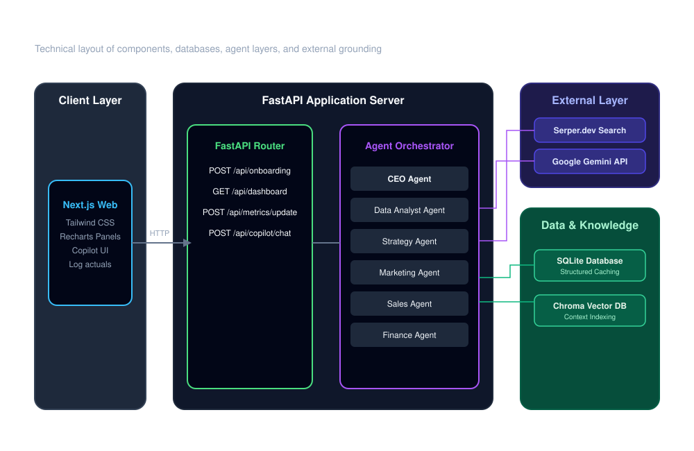
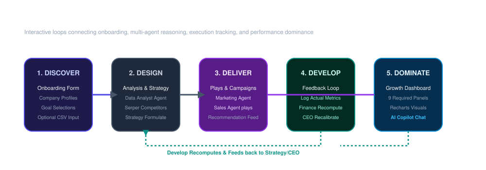

# AI-Powered Business Growth Operating System

An autonomous, multi-agent growth engine that implements the sponsor's **5D Framework (Discover &rarr; Design &rarr; Deliver &rarr; Develop &rarr; Dominate)** to analyze business health, crawl market dynamics via live search, recommend marketing and sales campaign playbooks, and track actual results against strategic targets in real-time.

---

## 5D Framework Mapping

This application maps each phase of the **5D Framework** to clean routes, database entities, and agent classes:

| Phase | Description | Implementation in Code |
| :--- | :--- | :--- |
| **Discover** | Multi-step form capturing company profile, goals, channels, and pain points + CSV upload. | `/onboarding` route & `OnboardingResponse` SQLite database model |
| **Design** | Multi-agent analysis pipeline compiling KPIs and competitor search context. | `DataAnalystAgent` & `StrategyAgent` modules, executing in `run_growth_pipeline` |
| **Deliver** | Parallel execution of campaigns and pipeline plays, cached in a unified recommendations feed. | `MarketingAgent` & `SalesAgent` modules, outputs cached to `AgentOutput` |
| **Develop** | Feedback loop allowing users to log actual metrics, triggering Finance re-projections. | `/api/business/{id}/metrics/update` route, `FinanceAgent` & `CEOAgent` re-runs |
| **Dominate** | Core visual command center with 9 panels, graphs, and the grounded AI Copilot chat drawer. | `/dashboard` route, Recharts visual panels, & `copilot_chat` endpoint |

---

## Diagrams

### 1. System Architecture Diagram
The architecture consists of a client UI communicating via CORS to a FastAPI python app, which runs an orchestrator pipeline routing information between Gemini, Serper, SQLite, and Chroma.



### 2. Business Growth Flow
The operational lifecycle loops from user inputs through sequential analysis, delivery, and a continuous feedback recompute loop.



---

## Agent Contracts Table

Each of the six agents is defined in its own file under `backend/app/agents/` with an explicit Pydantic schema enforcing outputs.

| Agent | Responsibility | Verbatim Input Schema | Verbatim Output Schema |
| :--- | :--- | :--- | :--- |
| **CEO Agent** | Synthesizes all other agents' outputs into an executive summary and top 3 priorities. | Outputs of all other agents + business profile. | `{executive_summary: str, top_priorities: list[str], overall_confidence: int}` |
| **Data Analyst Agent** | Turns raw onboarding answers + any uploaded data into structured metrics and flags gaps. | Onboarding form data (dictionary) + optional CSV upload string. | `{business_health_score: int, customer_health: int, kpis: dict, data_gaps: list[str]}` |
| **Strategy Agent** | Formulates the growth strategy, capability scores, and key bets. | Data Analyst output + industry context (via Serper search results). | `{strategy_name: str, rationale: str, growth_score: int, market_readiness: int, key_bets: list[str]}` |
| **Marketing Agent** | Generates tactical, channel-aligned campaigns. | Strategy Agent output. | `{campaigns: list[{channel: str, audience: str, message_angle: str, est_cost_tier: str, expected_impact: str}]}` |
| **Sales Agent** | Builds target niches and specific pipeline conversion plays. | Strategy Agent output + Data Analyst KPIs. | `{lead_score: int, pipeline_actions: list[{action: str, priority: str, expected_value: str}], target_segments: list[str]}` |
| **Finance Agent** | Projects revenue opportunity, issues warnings, and assesses projected-vs-actual variance. | Strategy + Marketing + Sales outputs, plus optional MetricSnapshot actual history. | `{revenue_opportunity: float, risk_alerts: list[str], budget_guidance: str, projected_vs_actual: dict}` |

---

## Technical Stack & Citation Sheet

This project runs 100% on free-tier, developer-friendly libraries and endpoints:

*   **Google Gemini API (`gemini-1.5-flash`)**: Used for structured reasoning and Copilot conversation. Runs on the free tier via Google AI Studio.
*   **Serper.dev (Google Search API)**: Used for competitor scans and live industry search grounding.
*   **FastAPI (Python)**: High-performance asynchronous backend API ecosystem.
*   **SQLAlchemy & SQLite**: Zero-configuration local database storing profile and snapshot history.
*   **ChromaDB / Vector Fallback**: Local Vector layer indexing reasoning chains for Copilot RAG queries.
*   **Next.js (App Router, JavaScript)**: Modern, single-page client framework.
*   **Tailwind CSS**: Sleek dark-mode styling with glassmorphism panels.
*   **Recharts**: Interactive data charting (Gauge charts, Bar charts, Trend Line graph).
*   **Lucide React**: Clean vector icon kit.

---

## Quick Start Setup

### 1. Pre-requisites
*   Node.js (v18+)
*   Python (3.10+)

### 2. Configure Environment
1. In the project root, duplicate `.env.example` and name it `.env`:
   ```bash
   cp .env.example .env
   ```
2. Open `.env` and fill in your keys:
   *   `GEMINI_API_KEY`: Get your free key from Google AI Studio.
   *   `SERPER_API_KEY`: Get your free search key from serper.dev.
   *   *Note: If keys are omitted, the application runs on high-fidelity mockup data, allowing reviewers and developers to test the full pipeline and feedback loop instantly!*

### 3. Boot Backend API
1. Navigate to `/backend` and install dependencies:
   ```bash
   cd backend
   pip install -r requirements.txt
   ```
2. Boot the uvicorn development server:
   ```bash
   uvicorn app.main:app --reload --port 8000
   ```
3. The server starts on `http://localhost:8000`. You can inspect the API swagger doc at `http://localhost:8000/docs`.

### 4. Boot Frontend Client
1. In a new terminal panel, navigate to `/frontend` and install packages:
   ```bash
   cd frontend
   npm install
   ```
2. Boot the Next.js dev server:
   ```bash
   npm run dev
   ```
3. Open `http://localhost:3000` to launch the onboarding wizard!

---

## Running Verification Tests

To verify the backend logic and the six agent schemas locally:
```bash
python backend/test_pipeline.py
```
This executes the Discover, Design, Deliver, and Develop loops on SQLite, asserting that all 6 agents compile outputs, compile the 9 dashboard panels, and successfully recalculate target-vs-actual metrics.
